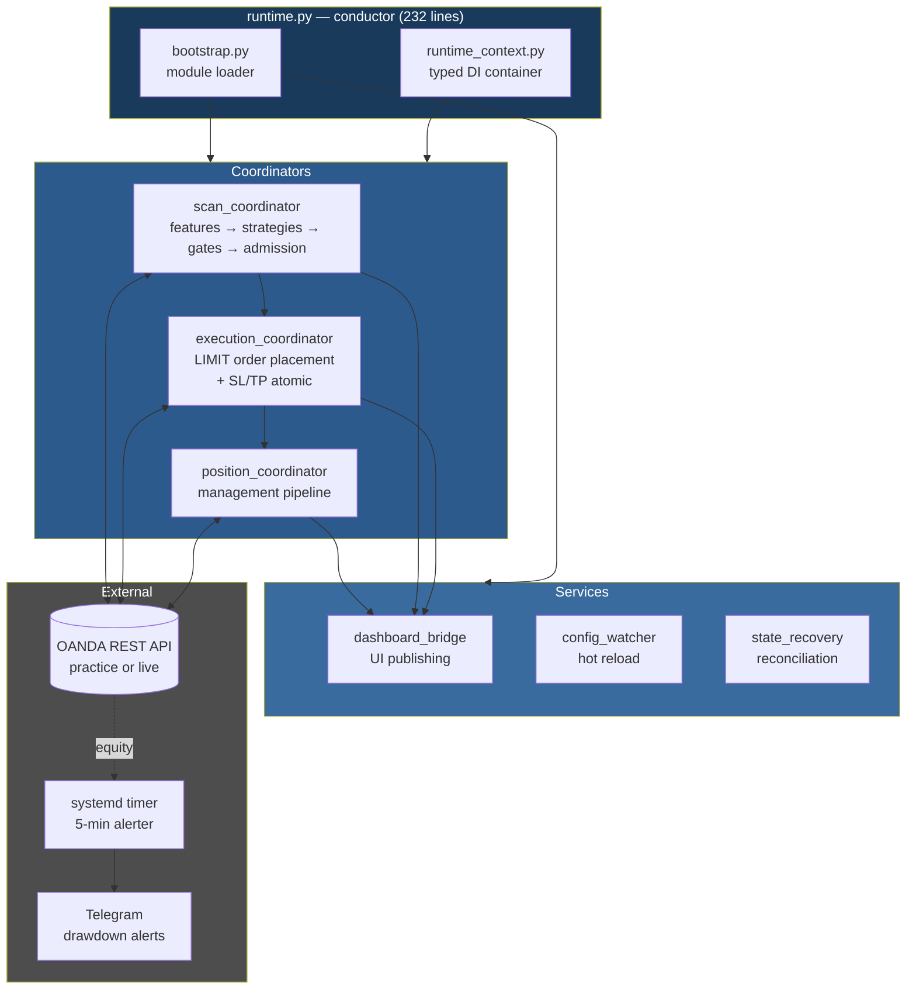
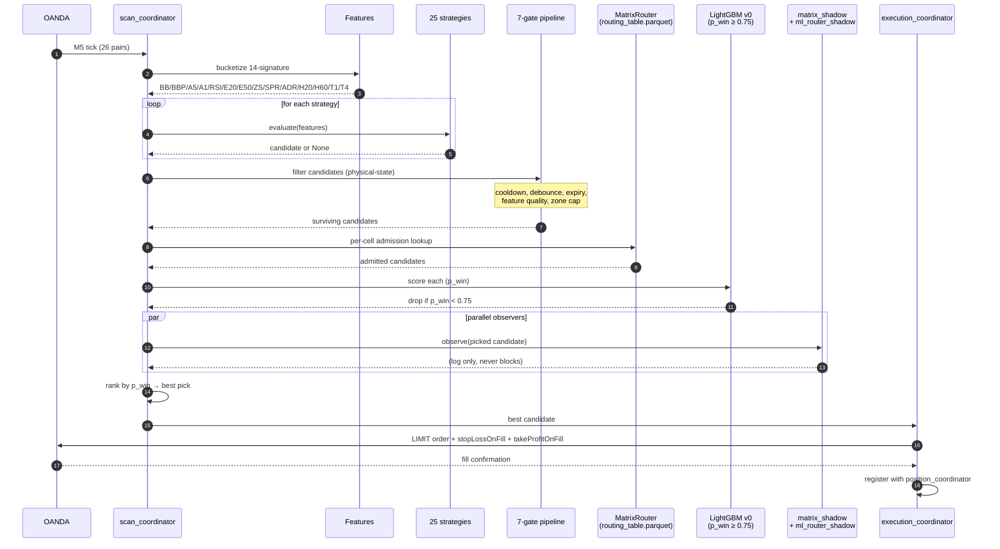
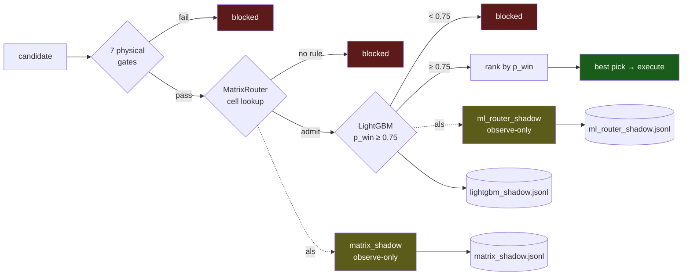
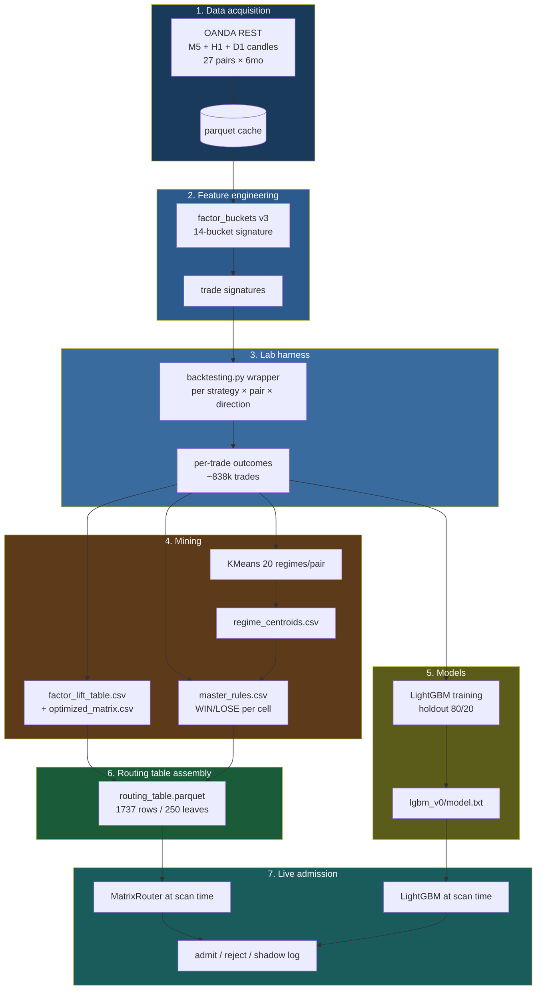
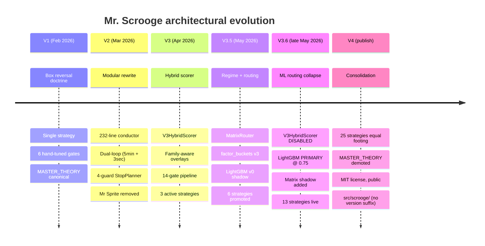
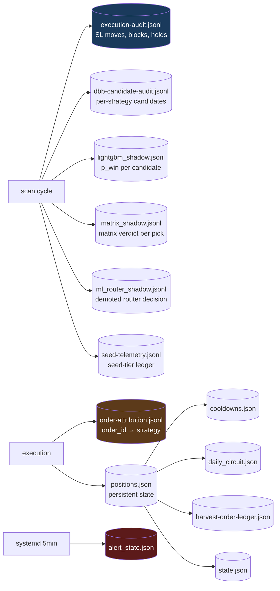

# Architecture Diagram

Visual map of how Mr. Scrooge V4 works. All diagrams render in GitHub
markdown via Mermaid.

Companion to [`LIVE_SYSTEM_SPEC.md`](LIVE_SYSTEM_SPEC.md) (the textual
"what it does today") and [`STRATEGY_ENCYCLOPEDIA.md`](STRATEGY_ENCYCLOPEDIA.md)
(per-strategy detail).

---

## 1. System overview

How the major modules talk to each other.

**Key:** The 232-line conductor `runtime.py` orchestrates three
coordinators (scan / execution / position) plus three services
(dashboard / config / recovery). All broker I/O routes through OANDA
REST. The Telegram alerter is **out-of-process** — it survives the bot
being sick.

---

## 2. Scan-to-execution sequence

What happens for a single market tick, end-to-end.

**Key:** Strategies emit; gates filter; router admits; LightGBM
scores; shadows record (never block); best pick wins; LIMIT-only
entries with SL/TP atomic (no naked windows).

---

## 3. Admission stack

Four-layer view of how a single candidate gets from "strategy emitted
it" to "broker fills it."

**Key:** Three parallel observers log to three JSONL ledgers.
Disagreement between LightGBM (gate) and the two shadows is the
highest-information audit signal in the system.

---

## 4. Strategy taxonomy

The ~25 strategies grouped by family. No strategy has privileged
status; the routing table decides which fires for which (pair × regime
× session) cell.

```mermaid
flowchart TB
    ROOT[scrooge.strategies — ~25 modules]

    ROOT --> CONT[Continuation family]
    ROOT --> REV[Reversion family]
    ROOT --> BOX[Box family]
    ROOT --> BREAK[Breakout family]
    ROOT --> OTHER[Other]

    CONT --> dbb_trend
    CONT --> trend_pullback
    CONT --> chaikin_macd_atr
    CONT --> canonical_lien_dbb
    CONT --> trend_aligned_breakout
    CONT --> session_momentum_all

    REV --> reversal
    REV --> compression_reversion
    REV --> MR2[MR2_bb_reversion]
    REV --> MR4[MR4_zscore_extreme]
    REV --> MR5[MR5_williams_extreme]
    REV --> RG1[RG1_range_bound_scalp]
    REV --> CP3[CP3_vol_coil_fade]

    BOX --> box_master_theory
    BOX --> canonical_darvas

    BREAK --> BR2[BR2_vcb<br/>volume compression breakout]
    BREAK --> BR5[BR5_opening_range_breakout]
    BREAK --> CP1[CP1_coil_breakout]
    BREAK --> CP2[CP2_squeeze_momentum]
    BREAK --> session_breakout
    BREAK --> compression_expansion

    OTHER --> ifvg[ifvg — inverse fair value gap]
    OTHER --> direct[direct — fallback]
    OTHER --> TF2[TF2_pullback_EMA20]

    style ROOT fill:#1a3a5c,color:#fff
    style CONT fill:#1a5c3a,color:#fff
    style REV fill:#5c3a1a,color:#fff
    style BOX fill:#5c1a5c,color:#fff
    style BREAK fill:#3a5c1a,color:#fff
    style OTHER fill:#5c5c5c,color:#fff
```

**Note:** Box reversal (`box_master_theory`) — originally the V1
flagship strategy — is now one entry of ~25, same template as every
other. Its detailed historical doctrine is preserved at
[`docs/archive/MASTER_THEORY_v1-box-reversal-origin-2025.md`](archive/MASTER_THEORY_v1-box-reversal-origin-2025.md).

---

## 5. Data flow — corpus to admission

How market data becomes admission decisions, end-to-end.

**Key:** Steps 1-6 are the lab pipeline (offline, periodic rebuilds).
Step 7 is live admission (continuous, runs every scan cycle). The lab
artifacts (`routing_table.parquet`, `lgbm_v0/model.txt`, per-pair
modules, matrix CSVs) are the bridge.

---

## 6. Evolution — V1 to V4

The chronology of how the architecture got here. Each era's
[history doc](history/) and [ADR set](decisions/) carries the detail.

**Key:** V1 → V4 is a 4-month arc. The dominant move was *from
hand-tuned scoring to lab-mined routing* — V3HybridScorer's death
(ADR 3017, May 28) was the watershed. V4 freezes this architecture
for publication; future iteration happens *within* this frame, not
*replacing* it.

---

## 7. Telemetry — what gets logged where

Every admitted trade leaves a trail across multiple ledgers.

**Key:** `order-attribution.jsonl` is the load-bearing audit artifact
— it links every broker fill back to its scoring snapshot (Patches A
+ B.right + C, [ADR 3006](decisions/3006-b1-attribution-architecture.md)).
Without it, broker-truth audits can't reliably split outcomes by
strategy.

---

## Diagram-rendering notes

All diagrams use Mermaid syntax and render natively in GitHub
markdown — no external tooling required. To regenerate as standalone
images (for slide decks or documentation outside this repo), use
either the [Mermaid CLI](https://github.com/mermaid-js/mermaid-cli) or
the official [Mermaid Live Editor](https://mermaid.live).

Diagrams are kept deliberately *coarse-grained*. Per-module detail
lives in [`LIVE_SYSTEM_SPEC.md`](LIVE_SYSTEM_SPEC.md); per-strategy
detail lives in [`STRATEGY_ENCYCLOPEDIA.md`](STRATEGY_ENCYCLOPEDIA.md);
per-decision detail lives in [`decisions/`](decisions/). These
diagrams are for orientation, not specification.
